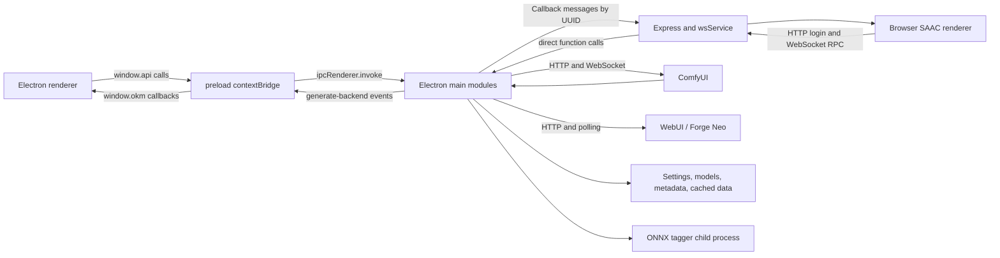

# Architecture and change navigation

Revalidated 2026-09-30 at `8e78e9c336c227f986bd4efd9ce5adde10d21646` on `codex/document-repository-for-ai-agents`.
Application source is unchanged from the original audit at `4d9e945ba3254ad1ef74bc6595490799b1c36993`.
This is a source-verified snapshot, not evidence of a successful GUI or generation run.
Statements below describe inspected code; recommendations and interpretations are explicitly labeled.
For backend workflow details use [COMFYUI.md](COMFYUI.md); for commands and validation use [DEVELOPMENT.md](DEVELOPMENT.md).

## Execution domains

- [package.json](../../package.json) selects ESM and [main.js](../../main.js) as the Electron entry. There is no frontend bundler or framework component tree: HTML loads browser ES modules directly.
- SAA is the desktop host. SAAC is the browser client of that same running host, not an independently running Node backend. [index_electron.html](../../index_electron.html) loads the desktop renderer; [index.html](../../index.html) loads the browser renderer.
- Main modules use Electron/Node privileges. Renderer modules use DOM APIs and either the preload API or the SAAC transport. Merely running a renderer module in Node will not reproduce its environment.

## Initialization and window lifecycle

1. `app.whenReady()` calls `initializeApp()` in [main.js](../../main.js).
2. Display fitting runs through [screenResolution.js](../../scripts/main/screenResolution.js); file handlers, global settings, layout handlers, common IPC and SAAC lifecycle IPC are registered.
3. `setupModelList(SETTINGS)` scans local model directories. `setupDownloadFiles()` fetches missing required data; `setupCachedFiles()` reads character/thumb/language assets.
4. Wildcards initialize before tag autocomplete. Remote/local prompt AI, both generation backends, and the ONNX image tagger register their handlers.
5. Only if download, cache and autocomplete setup succeed does the optional SAAC service start and `createWindow()` load the desktop HTML. Startup can therefore fail before a visible window; inspect terminal output and download/cache dependencies first.
6. The HTML loads [html_load_body.js](../../scripts/html_load_body.js) before its renderer; it inserts [html_shared_body.js](../../scripts/html_shared_body.js). Both desktop and browser use this same DOM skeleton.
7. Desktop `afterDOMinit()` / `init()` in [renderer.js](../../scripts/renderer.js) fetch settings/cache/lists, construct controls and slot managers, install gallery callbacks, then run the first-use wizard or restore settings. `globalThis.initialized` gates callbacks during setup/reload.

`createWindow()` sets `contextIsolation: true`, `nodeIntegration: false`, `nodeIntegrationInWorker: true`, `sandbox: false`, and `webSecurity: true`. Keep the preload/main privilege boundary when adding UI features.

Closing with connected SAAC clients invokes `confirmQuitIfSaacConnected()`: it cancels current ComfyUI and WebUI jobs **before** displaying confirmation. Confirmation waits up to 120 seconds; approval broadcasts `ServerShutdown` and closes the service. Window close, app quit, and service lifecycle changes share guards; do not add a second independent shutdown path.

## IPC and transport parity

[scripts/preload.js](../../scripts/preload.js) exposes two contracts:

- `window.api`: named asynchronous methods calling explicit `ipcRenderer.invoke` channels, including settings/files/models, generation, tagging, prompt AI, layout, logs and SAAC lifecycle.
- `window.okm`: renderer callback registration. The `generate-backend` event dispatches named `updatePreview`, `appendImage`, `updateProgress`, and spellcheck functions; quit confirmation uses a separate event/reply.

Main registration is split by responsibility (`setupFileHandlers`, `setupGlobalSettings`, `setupModelList`, `setupGenerateBackendComfyUI`, etc.), rather than one central IPC registry.

[wsService.js](../../scripts/webserver/back/wsService.js) separately maps public method names in `methodHandlers` to the same main functions. Browser callers use [wsRequest.js](../../scripts/webserver/front/wsRequest.js) `sendWebSocketMessage({ type: 'API', method, params })`. This is a parallel API surface, not an automatic mirror of preload.

**Change rule:** trace a method through caller, preload/channel/handler, and SAAC `methodHandlers` when it should work in both environments. Preserve argument order, return shape, error signaling and owner UUID. Do not expose an arbitrary IPC channel or arbitrary main function to the renderer.

## Renderer state, controls and persistence

There is no centralized reactive state store. State is distributed among:

| State | Ownership and implications |
| --- | --- |
| `globalThis.globalSettings` | Renderer copy of loaded settings; control callbacks mutate it. Main has a separate module-level `globalSettings`. Saving a renderer copy to disk is not a general live-state synchronization mechanism. |
| `globalThis.cachedFiles` | Language, characters, thumbnails, model choices and settings lists. Main also holds caches; browser initialization omits the large thumbnail payload and fetches individual thumbs. |
| `globalThis.generate`, `dropdownList`, `prompt`, `collapsedTabs` | Component instances and transient flags mixed with values. Generation reads component getters as well as settings. |
| `lora`, `controlnet`, `jsonlist`, `aDetailer`, `queueManager` | Slot managers with their own collections and UI. `flushSlots()` restores LoRA/ADetailer slot state when settings reload. |
| `mainGallery`, `thumbGallery`, `overlay`, `inGenerating` | In-memory image/UI/job state; not a durable server job database. |
| Browser `localStorage` | Gallery aspect ratios and overlay positions/sizes. These are distinct from settings JSON and layout sidecars. |

Control creation lives in `setupHeader`, `setupLeftRight`, `createGenerate`, `createPrompt`, `createHifixRefiner`, `createRegional`, and `createAI` in [renderer.js](../../scripts/renderer.js). These call factories in [components](../../scripts/renderer/components) such as `setupSlider`, `setupCheckbox`, `setupTextbox`, and `mySimpleList`, attached to IDs/classes in the shared HTML.

[globalSettings.js](../../scripts/main/globalSettings.js) is the persistent-settings schema: `setupGlobalSettings()` / `loadSettings()` clone `defaultSettings` and copy only recognized keys. **A new persistent key must be added there or loading silently ignores it with a warning.** Normal startup reads runtime `settings/settings.json`; named presets live under runtime `settings/*.json`. MiraITU presets use [settings/MiraITU](../../settings/MiraITU) and separate load/save functions.

Settings paths are based on `app.getAppPath()` in development and the executable's `resources/app` directory when packaged, not Electron `userData`. `saveSettings()` writes JSON synchronously (deleting an existing file first); persistence is not transactional. Do not put secrets into committed examples or print real settings in diagnostics.

The save button in [myCollapsed.js](../../scripts/renderer/components/myCollapsed.js) collects LoRA/ADetailer slots, dropdown weights and prompt textbox heights before saving. [callbacks.js](../../scripts/renderer/callbacks.js) `callback_mySettingList()` replaces renderer settings, reloads lists, reconciles favorites/theme/backend choices, calls `updateLanguage()` / `updateSettings()`, restores slots and reapplies layout.

Localization is data-driven in [data/language.json](../../data/language.json); [language.js](../../scripts/renderer/language.js) explicitly updates component titles and values. Add both language entries and the corresponding update wiring. `theme.js` sets the root `data-theme`; [html/theme.css](../../html/theme.css), [index_theme.css](../../html/index_theme.css), [index.css](../../html/index.css) and [gallery.css](../../html/gallery.css) split tokens and styling.

### Panel layout

[uiLayout.js](../../scripts/renderer/uiLayout.js) manages drag/drop, columns, full-width gallery sizing, mode switching and persistence; [uiLayoutTabs.js](../../scripts/renderer/uiLayoutTabs.js) manages tab hosts/pages. `setupUiLayout()` binds panel handles and applies saved layout.

[uiLayout_backend.js](../../scripts/main/uiLayout_backend.js) stores version-2 layout sidecars in runtime `settings/ui_layout`: `_global.json` plus per-preset files. Modes are `global`, `independent`, and `factory`. Loading/saving normalizes known panels, inserts missing panels in default order, and migrates stored shapes; some reads can therefore write migrations.

For a new panel, inspect the shared DOM `data-layout-id`, renderer `PANEL_IDS`, backend `DEFAULT_UI_LAYOUT` / `KNOWN_PANELS`, tab-zone restrictions and localization. The backend comment says to add panel defaults there, but renderer handle registration is also explicit. Retain stable IDs when possible so user layouts survive upstream and downstream upgrades.

## Generation, prompts and concurrency

[callbacks.js](../../scripts/renderer/callbacks.js) `callback_generate_start()` selects normal/regional/MiraITU generation. [generate.js](../../scripts/renderer/generate.js) constructs request data and inserts queue slots; `startQueue()` serially consumes that renderer's queue, using `globalThis.inGenerating` as its guard. [myQueueSlot.js](../../scripts/renderer/slots/myQueueSlot.js) `QueueManager` owns slot ordering/removal. SAAC clients each have their own renderer queue.

Prompt construction combines character/OC choices, view tags, tag-assist data, positive/negative text, custom JSON slots, LoRA selections and seed-based randomization. Key functions are `createPrompt`, `getCharacters`, `getPrompts`, `getLoRAs`, and `replaceWildcardsAsync`; helpers live in [nestedBraceParsing.js](../../scripts/renderer/tools/nestedBraceParsing.js) and [promptFilter.js](../../scripts/renderer/tools/promptFilter.js). [wildCards.js](../../scripts/main/wildCards.js) loads wildcard files and feeds autocomplete.

Optional prompt AI is a distinct subsystem: [remoteAI.js](../../scripts/renderer/remoteAI.js) `getAiPrompt()` supplies text during queue execution, via [remoteAI_backend.js](../../scripts/main/remoteAI_backend.js) Electron `net.request` chat-style HTTP calls. Queue requests retain AI options; prompt placeholders are replaced before backend submission.

Backend transport branches on `globalThis.inBrowser`: desktop invokes preload; SAAC makes RPC. For the full ComfyUI workflow/HTTP/WebSocket lifecycle read [COMFYUI.md](COMFYUI.md). [generate_backend_webui.js](../../scripts/main/generate_backend_webui.js) retains Forge/WebUI payload translation, ControlNet/ADetailer integration and HTTP preview polling. It also imports ComfyUI's `sendToRenderer()` helper, so that helper is shared infrastructure despite its filename.

Preview/progress callbacks pass through [renderer/generate_backend.js](../../scripts/renderer/generate_backend.js) to gallery/overlay UI. Normal ComfyUI final images return to the awaiting renderer generation helper, which calls `appendImageData` in [customGallery.js](../../scripts/renderer/customGallery.js) directly; the callback bridge also supports `appendImage`. Keep these delivery paths and final metadata consistent when changing backend return values.

Shared main-process locking lives in [main-common.js](../../main-common.js): `busySlots` is protected by `async-mutex`; `tryAcquireBackendBusy(kind, addr, ownerUuid)` / `releaseBackendBusy()` use a backend-kind/address key and owner. Backend instances retain per-address state; renderer serialization is not a substitute for host locks shared by SAA, SAAC and Python requests.

- `makeBackendLockKey()` strips scheme/path and splits host/port; do not assume it canonicalizes DNS aliases, loopback aliases or all URL forms.
- Busy requests fail rather than entering a global fair queue. [autoRetry.js](../../scripts/renderer/tools/autoRetry.js) retries using settings and recognizes a specific busy-error string. Changing that text is a behavior change.
- Skip, skip-current and cancel differ in [callbacks.js](../../scripts/renderer/callbacks.js); cancellation touches queue state, retry timers and the owning backend. Preserve all three behaviors.
- Model reload's explicit `unlockMutex` path in `updateModelAndLoRAList()` force-clears **all** backend locks (the source calls this the Skeleton Key). Ordinary settings reload must not request it. It does not constitute an orderly completion of in-flight work.

## Files, model discovery, metadata and tagging

| Concern | Verified path and boundary |
| --- | --- |
| Required startup datasets | [downloadFiles.js](../../scripts/main/downloadFiles.js) downloads missing character/thumb/tag files; [cachedFiles.js](../../scripts/main/cachedFiles.js) loads them alongside local OC/view/language data. These can change independently of the code snapshot. |
| Model choices | [modelList.js](../../scripts/main/modelList.js) scans the SAA host filesystem, with recursion/filtering, per-backend lists, ComfyUI extra paths and optional [data/custom_path.yaml](../../data/custom_path.yaml). Lists are not proof that a remote ComfyUI instance can load those models. |
| Extra model paths | `readExtraModelPaths()` computes the YAML location from `model_path_comfyui` and currently reads the `a111.base_path` section; it is not a general implementation of every ComfyUI YAML section. `resolveCustomPaths()` handles the repository's separate custom-path scheme. |
| Generic files / safetensors | [fileHandlers.js](../../scripts/main/fileHandlers.js) `loadFile()` selects CSV/JSON/base64 handling; `readSafetensors()` reads metadata, including alternate model paths. Main owns filesystem access. |
| Image metadata | `readImage()` / `readBase64Image()` parse PNG/JPEG/WebP containers in main. [imageInfoMetadata.js](../../scripts/renderer/components/imageInfoMetadata.js) interprets generation metadata and [imageInfo.js](../../scripts/renderer/imageInfo.js) coordinates upload/drop/paste and application to controls. |
| Image operations | [imageInfoControlNet.js](../../scripts/renderer/components/imageInfoControlNet.js), [imageInfoMiraITU.js](../../scripts/renderer/components/imageInfoMiraITU.js), [imageInfoDataFiles.js](../../scripts/renderer/components/imageInfoDataFiles.js) separate feature actions; [imageInfoUtils.js](../../scripts/renderer/components/imageInfoUtils.js) handles blobs/canvas/resizing. |
| Tag suggestions | [tagAutoComplete_backend.js](../../scripts/main/tagAutoComplete_backend.js) builds suggestions from downloaded tags, translations and wildcards; [tagAutoComplete.js](../../scripts/renderer/tagAutoComplete.js) renders textbox suggestions. |
| Image tagger | [imageTagger.js](../../scripts/main/imageTagger.js) `runImageTagger()` normally forks [imageTaggerFork.js](../../scripts/main/imageTaggerFork.js), with a 10-second subprocess timeout; `wait: true` selects direct main-process execution. ONNX WD, CL and Camie implementations live in [tagger](../../scripts/main/tagger), with model assets under [models/tagger](../../models/tagger). This is JavaScript/ONNX, separate from Python utilities. |

## SAAC service and trust boundaries

`setupHttpServer()` in [wsService.js](../../scripts/webserver/back/wsService.js) serializes start/stop through `lifecycleMutex`; the service is optional and controlled from Electron. `/api/ws-config` supplies the browser WS address; `/api/login` issues a UUID token. `registerUUID` binds token/IP/socket; API messages must match the registered socket. Requests carry increasing IDs; responses are `APIResponse` / `APIError`, and pushed UI events are `Callback` messages.

[wsRenderer.js](../../scripts/webserver/wsRenderer.js) duplicates desktop initialization using RPC, while importing shared UI constructors from `renderer.js`. That import also installs the desktop DOM-ready handler, whose missing-`api` failure is caught with a source comment acknowledging SAAC. **Interpretation:** consolidating initialization is an extension seam, but changing imports/side effects needs both entry points tested.

Verified security-sensitive behavior to preserve or deliberately redesign in a scoped security task:

- HTTPS is enabled only when certificate, private-key and users files are readable; environment `SSL_CERT_PATH` / `SSL_KEY_PATH` can override certificate paths. Otherwise startup falls back to HTTP.
- HTTP login bypasses credentials. HTTPS login checks bcrypt hashes and temporarily blocks failed-login IPs. Do not equate having a UUID with strong authentication in HTTP mode.
- `express.static(basePath)` serves the app root before the explicit `/` route, without an authentication middleware. This exposes a much broader tree than UI assets. Review settings, logs and certificate placement before expanding network exposure; actual deployment exposure **Needs runtime verification**.
- SAAC `getGlobalSettings` returns the host settings object; generic file-reading and backend-log RPCs are exposed. Existing file helpers are not a comprehensive path-containment sandbox. Avoid adding secrets to payloads or treating remote clients as isolated tenants.
- `ws_saac_readonly` defaults true and blocks selected persistence operations; it allows saving `saac_settings.json`, generation and reads. `loadSettingFile` still invokes shared main `loadSettings()`. This is a feature restriction, not a full security boundary or independent per-client configuration store.
- Electron's CSP and preload isolation are separate from server access control. User-controlled prompt/metadata/text rendering deserves HTML-injection review wherever DOM insertion is used.

`wsRequest.js` rejects outstanding RPCs and clears callbacks on close; send attempts may reconnect, but there is no general per-request timeout in `sendWebSocketMessage()`. Host shutdown suppresses reconnection. Re-registration of UI callbacks after disconnect **Needs runtime verification**.

## Error investigation and downstream extension seams

Main logging is captured by [main-common.js](../../main-common.js) into an 800-line ring via wrapped console methods, exposed by `getBackendLogs`; the UI can view/copy it. SAAC authentication/access events also append to runtime `logs/auth.log`. Renderer errors remain in its console. Redact settings, prompts, paths and credentials when sharing logs.

Error contracts vary: some functions throw, some resolve error strings, and others return `false`, `null` or `{ error }`. Generation adapters translate results to `{ ret, retCopy, breakNow }`. Trace callers before standardizing any return type. Renderer queue cleanup does not have a broad `try/finally`; a thrown call can strand transient UI/job flags.

**Recommendations based on the inspected coupling:**

- Add focused helpers behind existing entry points; keep pure prompt/workflow transformations separate from DOM, Electron and filesystem work when extending functionality.
- New UI settings usually touch shared HTML, a constructor, `defaultSettings`, `language.js`, translation data and request packing. New panels also touch layout registries. Update the smallest complete vertical path.
- A new host capability generally needs both preload IPC and SAAC RPC mappings plus response/error parity; host-only controls should remain explicitly host-only.
- Removing or replacing a feature requires tracing saved settings, UI constructors/update wiring, slot and layout IDs, both transport surfaces, workflow branches, and metadata consumers. Decide how old profiles/layouts load before deleting those contracts; remove dead callbacks and translations with their callers.
- For removal/replacement, trace saved keys and slot data, shared DOM IDs, both transport mappings, language updates, queue request packing and workflow consumers before deleting code. Decide how old presets/layouts migrate: unknown settings keys are dropped and unknown layout panels are normalized away. Preserve compatibility adapters where they avoid breaking existing user data or Python/SAAC callers.
- Keep backend-specific workflows and model assumptions out of generic queue/gallery code. Preserve WebUI branches when improving the primary ComfyUI path.
- Treat shared settings/cache mutation, tagger subprocess response handling and forced lock release as concurrency hotspots. Tagger subprocess listeners do not correlate replies against the generated request ID; concurrent tagging **Needs runtime verification** before expanding that use.
- Likely upstream conflict hotspots are [renderer.js](../../scripts/renderer.js), [html_shared_body.js](../../scripts/html_shared_body.js), [globalSettings.js](../../scripts/main/globalSettings.js), [language.js](../../scripts/renderer/language.js), [data/language.json](../../data/language.json), [generate.js](../../scripts/renderer/generate.js), backend workflow files and layout registries. Prefer narrow integration points and avoid unrelated formatting in these files.

Packaging, Python utility ownership, environment setup and the local-versus-cloud validation boundary are covered in [DEVELOPMENT.md](DEVELOPMENT.md). Changes to these relationships should update this reference; routine implementation details need not expand the always-loaded [AGENTS.md](../../AGENTS.md).
